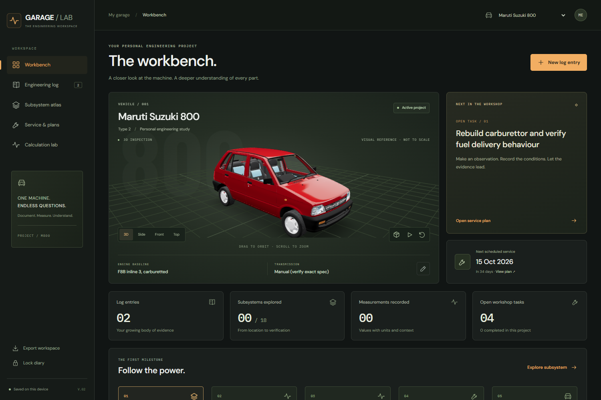

# Garage / Lab 0.2 — verification

Verified on Windows on 11 September 2026.

## Automated checks

- `npm run build`: production build passes. The main UI is approximately 186 kB uncompressed; the Three.js viewer is a separate, lazy-loaded chunk.
- `npm test`: five passing tests cover non-destructive legacy migration, rejection of malformed records, calendar-day service dates, drivetrain equations and unit conversions, and invalid calculation inputs.
- `npm run test:desktop`: the built `dist` loads through Electron's `file://` protocol in an isolated, in-memory session. Login, workbench, and loaded model are verified with HTTP(S) requests blocked and no renderer errors.

## Browser flows exercised

- Local password unlock and vehicle navigation.
- Actual Maruti and Ignis model rendering, wireframe toggle, and consistent model orientation.
- A measurement record with a numeric value, unit, and operating conditions; saved data survives reload.
- Log search, readback of the saved measurement, and the empty search state.
- Workshop task creation and completion; saved progress survives reload without changing the other vehicle.
- Subsystem progress and notes; both survive reload.
- Calculator output and the prefilled engineering entry with hypothesis status and assumptions.
- A deliberately malformed stored record produces a recovery warning and remains unchanged in storage.
- A 390 px viewport has a 390 px document width. Vehicle framing adapts to narrow screens, and navigation, export, and lock controls remain accessible.

Test records used isolated browser sessions, not the owner's Electron diary. The production desktop build uses local fonts, local models, and relative asset paths. Original source models remain unchanged. The existing local password is a convenience lock; records remain device-local and JSON backup import is not implemented.

